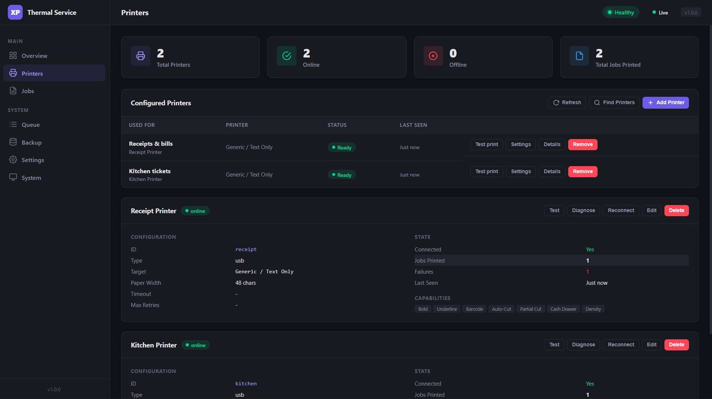
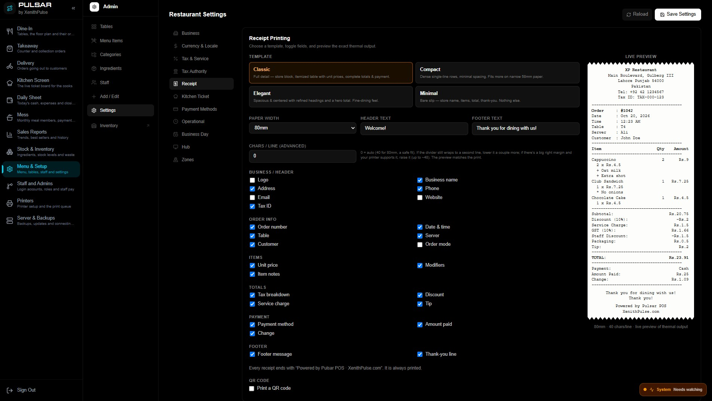

<div align="center">

# XP Thermal Service

**Free, open-source thermal printing for web POS apps. A zero-fee alternative to QZ Tray.**

Print receipts, kitchen tickets (KOT), barcodes and QR codes from any browser app to USB or network ESC/POS printers, through a self-healing Windows service.

[](LICENSE)


[](https://github.com/xenithpulse/xp-thermal-service/releases/latest)

[**Download**](https://github.com/xenithpulse/xp-thermal-service/releases/latest) · [Product page](https://xenithpulse.com/products/thermal-printer-service) · [XP Restaurant POS](https://xenithpulse.com/products/restaurant-pos) · [Need integration help?](https://wa.me/97455911793?text=XP%20Thermal%20Service%20integration)

<!-- Add these two images to a /docs folder in the repo -->




</div>

---

## Why this exists

Browsers can't talk to thermal printers directly, so most web POS systems rely on QZ Tray and pay a licence per deployment. We needed reliable printing for our own [XP Restaurant POS](https://xenithpulse.com/products/restaurant-pos), so we built a production-grade service and open-sourced it.

| | XP Thermal Service | QZ Tray |
| --- | --- | --- |
| Silent printing (no trust warnings) | Free | Requires Premium Support certificate ($599/year) |
| Licence | MIT | LGPL 2.1 |
| Install | One-click `setup.bat` | Desktop installer + certificate signing setup |
| Runs as | Self-healing Windows service | Tray app |
| Built-in receipt/KOT templates | Yes, send JSON | No, you build the print data |

<sub>QZ Tray pricing from buy.qz.io as of October 2026; verify current terms with QZ.</sub>

## Built into XP Restaurant POS

XP Thermal Service ships **built in** with [XP Restaurant POS](https://xenithpulse.com/products/restaurant-pos). It installs as one of the POS's Windows services and handles receipts, KOTs and the cash drawer out of the box, with no extra setup.

Want the whole system instead of building your own? **XP Restaurant POS is $299 once, with no subscription and unlimited tills.** [See the POS →](https://xenithpulse.com/products/restaurant-pos)

Building your own POS? Use this service standalone. It works with any web app that can send an HTTP request.

## Features

- **Bulletproof Installation**: One-click `setup.bat` with pre-flight checks, retry logic, and automatic recovery
- **Self-Healing Service**: Auto-restart on crash (5s/10s/30s delays), watchdog every 5 minutes, delayed auto-start on boot
- **Multiple Printers**: Support for USB and network thermal printers with auto-discovery
- **ESC/POS Support**: Full ESC/POS command support including barcodes, QR codes, and formatting
- **Templates**: Built-in templates for receipts, KOT, invoices, labels, test pages, and raw ESC/POS
- **Secure API**: Localhost-only binding, CORS protection, Chrome Private Network Access (PNA) support, rate limiting with burst protection
- **Smart Port Handling**: Automatic port fallback (9100–9110) if primary port is busy
- **Job Persistence**: SQLite-backed queue with crash recovery and automatic database repair
- **Idempotent**: Duplicate job prevention with idempotency keys
- **Queue Management**: Priority queuing, concurrent job processing, pause/resume
- **Health Monitoring**: Always-healthy liveness endpoint (only degrades during USB scanning), metrics, and dashboard
- **Config Auto-Recovery**: Corrupt config.json is backed up and rebuilt from example automatically

## Quick Start

### One-Click Install (Recommended)

1. Download the latest zip from [**Releases**](https://github.com/xenithpulse/xp-thermal-service/releases/latest) and extract it.
2. Right-click `setup.bat` → **Run as administrator**. It will:
   1. Check for Node.js 18+
   2. Install dependencies
   3. Build the TypeScript project
   4. Create `config.json` from example if missing
   5. Install as a Windows service with auto-start
   6. Open the dashboard in your browser
3. Send a test print from the dashboard at `http://localhost:9100/dashboard`.

### Your first print

```js
await fetch("http://localhost:9100/api/print", {
  method: "POST",
  headers: { "Content-Type": "application/json" },
  body: JSON.stringify({
    idempotencyKey: "order-4821-kot",
    printerId: "kitchen",
    templateType: "kot",
    payload: {
      orderNumber: "4821",
      tableName: "Table 12",
      items: [
        { name: "Margherita", quantity: 2 },
        { name: "Garlic Bread", quantity: 1 }
      ]
    }
  })
});
```

### Manual Installation

```bash
# Clone the repository
git clone https://github.com/xenithpulse/xp-thermal-service.git
cd xp-thermal-service

# Install dependencies
npm install

# Copy and configure
cp config.example.json config.json
# Edit config.json with your printer settings

# Build
npm run build

# Start (foreground)
npm start
```

### As a Windows Service

```bash
# Install as Windows service (requires Administrator)
npm run service:install

# Start the service
npm run service:start

# Stop the service
npm run service:stop

# Uninstall
npm run service:uninstall
```

### PowerShell Installer (Advanced)

```powershell
# Install (Run PowerShell as Administrator)
.\scripts\install.ps1

# Repair (reinstall without losing config)
.\scripts\install.ps1 -Repair

# Start / Stop / Restart
.\scripts\install.ps1 -Start
.\scripts\install.ps1 -Stop
.\scripts\install.ps1 -Restart

# Uninstall
.\scripts\install.ps1 -Uninstall

# Silent install (no console output)
.\scripts\install.ps1 -Silent

# Custom config file
.\scripts\install.ps1 -ConfigPath "C:\path\to\config.json"
```

## API Reference

### Health Check

```
GET http://localhost:9100/health
```

Response (always HTTP 200 unless actively scanning USB ports):

```json
{
  "status": "healthy",
  "uptime": 3600000,
  "version": "1.0.0",
  "printers": { "total": 2, "online": 1, "offline": 1, "initializing": false },
  "queue": { "pending": 0, "processing": 0, "failed": 0 }
}
```

> **Note:** The health endpoint returns `"status": "healthy"` even when printers are offline, since printers being offline is normal. It only returns `"status": "initializing"` during active USB port scanning at startup.

### Print a Receipt

```http
POST http://localhost:9100/api/print
Content-Type: application/json

{
  "idempotencyKey": "order-12345-receipt",
  "templateType": "receipt",
  "payload": {
    "orderNumber": "12345",
    "orderDate": "2026-01-15",
    "items": [
      {"name": "Burger", "quantity": 2, "price": 12.99, "total": 25.98},
      {"name": "Fries", "quantity": 2, "price": 4.99, "total": 9.98}
    ],
    "subtotal": 35.96,
    "tax": 2.88,
    "total": 38.84,
    "header": {
      "storeName": "Joe's Diner",
      "storeAddress": ["123 Main St", "City, State 12345"],
      "storePhone": "(555) 123-4567"
    },
    "footer": {
      "thankYouMessage": "Thank you for dining with us!"
    }
  }
}
```

### Print a Kitchen Order Ticket (KOT)

```http
POST http://localhost:9100/api/print
Content-Type: application/json

{
  "idempotencyKey": "order-12345-kot-kitchen",
  "printerId": "kitchen",
  "templateType": "kot",
  "priority": 2,
  "payload": {
    "orderNumber": "12345",
    "tableName": "Table 5",
    "serverName": "John",
    "orderTime": "14:35",
    "items": [
      {"name": "Burger", "quantity": 2, "modifiers": ["No onions", "Extra cheese"]},
      {"name": "Fries", "quantity": 2, "notes": "Extra crispy"}
    ],
    "notes": "Rush order"
  }
}
```

### Print to a Specific Printer

```http
POST http://localhost:9100/api/print/kitchen
Content-Type: application/json

{
  "idempotencyKey": "order-12345-kot",
  "templateType": "kot",
  "payload": { ... }
}
```

### Job Management

```
GET    /api/jobs/{jobId}                 # Job details
GET    /api/jobs/{jobId}/status          # Status with history
GET    /api/jobs?status=pending&limit=50 # List jobs (filters: status, printerId, limit)
DELETE /api/jobs/{jobId}                 # Cancel a job
POST   /api/jobs/{jobId}/retry           # Retry a failed job
POST   /api/jobs/clear-failed            # Clear all failed jobs
```

### Printer Management

```
GET  /api/printers                       # List all printers
GET  /api/printers/{printerId}           # Printer details
GET  /api/printers/{printerId}/status    # Printer status
POST /api/printers/{printerId}/test      # Send a test print
POST /api/printers/{printerId}/reconnect # Reconnect a printer
GET  /api/system/printers                # System-detected printers (Windows)
```

### Queue Management

```
GET  /api/queue/stats   # Queue stats
POST /api/queue/pause   # Pause the queue
POST /api/queue/resume  # Resume the queue
```

### System & Metrics

```
GET /api/metrics             # Service metrics
GET /api/system/info         # System info
GET /api/system/connections  # Active connections
```

### Configuration Management

```
GET    /api/config                        # Current config
PUT    /api/config/server                 # Update server settings
PUT    /api/config/security               # Update security settings
POST   /api/config/printers               # Add a printer
PUT    /api/config/printers/{printerId}   # Update a printer
DELETE /api/config/printers/{printerId}   # Delete a printer
```

### Dashboard

```
http://localhost:9100/dashboard
```

Web-based dashboard for monitoring printers, queue, jobs, and managing configuration.

## Configuration

The service uses `config.json` in the project root. Copy `config.example.json` to get started:

```json
{
  "server": {
    "host": "127.0.0.1",
    "port": 9100,
    "enableHttps": false
  },
  "security": {
    "allowedOrigins": [
      "http://localhost:3000",
      "http://127.0.0.1:3000"
    ],
    "allowedHosts": ["localhost", "127.0.0.1"],
    "rateLimitPerMinute": 120,
    "enableApiKey": false,
    "maxPayloadSize": 1048576
  },
  "queue": {
    "maxConcurrentJobs": 3,
    "maxRetries": 5,
    "retryDelayMs": 1000,
    "retryBackoffMultiplier": 2,
    "maxRetryDelayMs": 60000,
    "jobTimeoutMs": 30000,
    "cleanupIntervalMs": 3600000,
    "maxJobAgeMs": 604800000,
    "persistPath": "./data/jobs.db"
  },
  "logging": {
    "level": "info",
    "file": "./logs/service.log",
    "console": true
  },
  "printers": [
    {
      "id": "cashier",
      "name": "Cashier Receipt Printer",
      "type": "network",
      "enabled": true,
      "isDefault": true,
      "host": "192.168.1.101",
      "port": 9100,
      "timeout": 10000,
      "maxRetries": 3,
      "capabilities": {
        "maxWidth": 48,
        "supportsBold": true,
        "supportsUnderline": true,
        "supportsBarcode": true,
        "supportsQRCode": true,
        "supportsImage": false,
        "supportsCut": true,
        "supportsPartialCut": true,
        "supportsCashDrawer": true,
        "supportsDensity": true,
        "codepage": 0
      }
    },
    {
      "id": "usb-receipt",
      "name": "USB Receipt Printer",
      "type": "usb",
      "enabled": false,
      "isDefault": false,
      "printerName": "XP-80C",
      "timeout": 10000,
      "maxRetries": 3,
      "capabilities": {
        "maxWidth": 48,
        "supportsBold": true,
        "supportsUnderline": true,
        "supportsBarcode": true,
        "supportsQRCode": true,
        "supportsImage": false,
        "supportsCut": true,
        "supportsPartialCut": false,
        "supportsCashDrawer": true,
        "supportsDensity": true,
        "codepage": 0
      }
    }
  ]
}
```

> **Allowed origins:** add the exact URL of your POS (e.g. `https://your-pos.example.com`) to `security.allowedOrigins`. Avoid `"*"` in production: it lets any website you visit send jobs to your printer.

> **Note for USB printers:** Set `printerName` to match your Windows printer name exactly as shown in Control Panel > Devices and Printers.

## Template Types

| Type      | Description                                                                         |
| --------- | ----------------------------------------------------------------------------------- |
| `receipt` | Full receipt with header, items, totals, payment info, and optional barcode/QR code |
| `kot`     | Kitchen order ticket with large text, modifiers, and special instructions           |
| `invoice` | Detailed invoice with customer info and line items                                  |
| `test`    | Test print with font samples, alignment tests, and optional barcode/QR code         |
| `label`   | Label printing                                                                      |
| `raw`     | Direct ESC/POS commands (hex, base64, or raw bytes)                                 |

## Integration with Next.js / React

```ts
// lib/print-service.ts
const PRINT_SERVICE_URL = 'http://localhost:9100';

export async function printReceipt(order: Order) {
  const response = await fetch(`${PRINT_SERVICE_URL}/api/print`, {
    method: 'POST',
    headers: { 'Content-Type': 'application/json' },
    body: JSON.stringify({
      idempotencyKey: `order-${order.id}-receipt`,
      templateType: 'receipt',
      payload: {
        orderNumber: order.id,
        orderDate: new Date().toLocaleDateString(),
        items: order.items.map(item => ({
          name: item.name,
          quantity: item.quantity,
          price: item.price,
          total: item.quantity * item.price
        })),
        subtotal: order.subtotal,
        tax: order.tax,
        total: order.total
      }
    })
  });

  return response.json();
}

export async function checkPrintStatus(jobId: string) {
  const response = await fetch(`${PRINT_SERVICE_URL}/api/jobs/${jobId}/status`);
  return response.json();
}
```

> **Chrome Private Network Access:** The service includes PNA headers (`Access-Control-Allow-Private-Network: true`) so public websites (e.g., deployed on Vercel) can call `localhost` without CORS errors in Chrome.

## Error Handling

| Code                | Description                          |
| ------------------- | ------------------------------------ |
| `PRINTER_NOT_FOUND` | Specified printer doesn't exist      |
| `PRINTER_OFFLINE`   | Printer is not connected             |
| `PRINTER_TIMEOUT`   | Print operation timed out            |
| `JOB_NOT_FOUND`     | Job ID doesn't exist                 |
| `JOB_DUPLICATE`     | Job with same idempotency key exists |
| `INVALID_REQUEST`   | Invalid request payload              |
| `RATE_LIMITED`      | Too many requests                    |

## Job Lifecycle

```
pending → queued → processing → printing → completed
                                    ↓
                                  failed → retry_scheduled → processing (retry)
                                    ↓
                               dead_letter (max retries exceeded)

                              cancelled (user-initiated)
```

| Status            | Description                             |
| ----------------- | --------------------------------------- |
| `pending`         | Job created, waiting to be processed    |
| `queued`          | Job added to processing queue           |
| `processing`      | Template being rendered                 |
| `printing`        | Data being sent to printer              |
| `completed`       | Print successful                        |
| `failed`          | Print failed (may retry)                |
| `retry_scheduled` | Waiting for retry (exponential backoff) |
| `dead_letter`     | Failed after max retries                |
| `cancelled`       | Cancelled by user                       |

## Development

```bash
npm run dev     # Development mode (ts-node)
npm run build   # Build TypeScript
npm start       # Start production
npm test        # Run tests
npm run lint    # Lint
npm run cli     # CLI tool
```

## System Requirements

- **Node.js** 18+ (tested up to v25)
- **Windows** 7/10/11
- **Disk space**: 200MB minimum
- USB drivers for USB printers
- Network access for LAN printers

## Deployment to Client PCs

### One-Click Setup

1. Copy the project folder to the client PC
2. Right-click `setup.bat` → **Run as administrator**
3. Done. The service is installed, running, and will auto-start on every boot

### What the Installer Does

The PowerShell installer (`scripts/install.ps1`) performs:

1. **Pre-flight checks**: Admin rights, Node.js 18+, disk space (200MB), Windows version
2. **Cleanup**: Stops and removes any previous service installations (including legacy names)
3. **File deployment**: Copies dist, node_modules, public, config to `C:\ProgramData\XPThermalService`
4. **Config management**: Backs up existing config, restores from backup if missing, creates from example as fallback
5. **Port discovery**: Finds an available port in range 9100–9110
6. **Service registration**: Registers via `node-windows` with `sc.exe` fallback
7. **Recovery configuration**: Auto-restart on failure after 5s, 10s, 30s; delayed auto-start on boot
8. **Watchdog**: Scheduled task running every 5 minutes under SYSTEM account to ensure the service stays alive
9. **Health verification**: Waits up to 105s for service process + HTTP health endpoint

### Service Management

```powershell
Get-Service "XP Thermal Print Service"   # Check status
.\scripts\install.ps1 -Start
.\scripts\install.ps1 -Stop
.\scripts\install.ps1 -Restart
.\scripts\install.ps1 -Repair             # Reinstall without losing config/data
.\scripts\install.ps1 -Uninstall
```

### Auto-Start & Self-Healing

- **Delayed auto-start** on Windows boot
- **Windows Service Recovery**: Restarts after 5s, 10s, 30s on failure
- **Watchdog**: Scheduled task checks every 5 minutes, restarts if stopped
- **Active port file**: Written to `C:\ProgramData\XPThermalService\active_port.txt` and `C:\ProgramData\XPThermalService\data\active_port.txt` for external discovery

### Installation Logs

- **Install log**: `%TEMP%\XPThermalInstall_<timestamp>.log`
- **Service logs**: `C:\ProgramData\XPThermalService\logs\`
- **Watchdog log**: `C:\ProgramData\XPThermalService\logs\watchdog.log`
- **Config backups**: `C:\ProgramData\XPThermalService\backups\`

## Smart Port Handling

The service uses smart port allocation across the range **9100–9110**:

1. **Service side**: If port 9100 is in use, automatically tries 9101, 9102, etc.
2. **Client side**: The ThermalPrintAdapter scans ports 9100–9109 to find the service
3. **Port persistence**: The active port is written to `active_port.txt` and cached in the client's localStorage

This keeps the POS connected if another application is using port 9100, the service restarts on a different port, or the port changes after a Windows update.

## Connecting from XP Restaurant POS

XP Restaurant POS connects automatically through its built-in `ThermalPrintAdapter`. The snippet below shows how the adapter works if you're building something similar.

```ts
import { getThermalAdapter, ThermalPrintService } from './printing-facility';

const printService = ThermalPrintService.getInstance({
  autoReconnect: true,
  reconnectInterval: 5000,
  healthCheckInterval: 30000,
  onConnectionChange: (connected) => {
    console.log(`Thermal service: ${connected ? 'connected' : 'disconnected'}`);
  }
});

await printService.initialize();

if (printService.isConnected()) {
  const result = await printService.printBill(billData, {
    copies: 2,
    openCashDrawer: true
  });
  console.log('Print job:', result.jobId);
}
```

The adapter caches the last successful port in localStorage, probes it first on reconnection, scans 9100–9109 if it fails, and retries with exponential backoff.

```ts
await printService.reconnect();              // Force reconnect with port re-discovery
console.log(printService.getServiceUrl());   // Current service URL (for debugging)
```

## Troubleshooting

### Service Won't Start

1. Check logs: `C:\ProgramData\XPThermalService\logs\`
2. Verify Node.js is in PATH: `node --version`
3. Check Windows Event Viewer → Application logs
4. Try repairing: `.\scripts\install.ps1 -Repair`
5. Check install log: `%TEMP%\XPThermalInstall_*.log`

### POS Can't Connect

1. Verify service is running: `Get-Service "XP Thermal Print Service"`
2. Check the active port: `type C:\ProgramData\XPThermalService\active_port.txt`
3. Test health endpoint: `curl http://127.0.0.1:9100/health`
4. Check dashboard: `http://127.0.0.1:9100/dashboard`
5. Check CORS: Ensure your POS origin is in `security.allowedOrigins`

### Printer Not Printing

1. Verify printer is online in the dashboard
2. Send a test print from the dashboard
3. Check if `printerName` matches the Windows printer name exactly (for USB printers)
4. For network printers, verify IP and port are reachable

### Common Issues

| Issue                            | Solution                                                                           |
| -------------------------------- | ---------------------------------------------------------------------------------- |
| Port 9100 in use                 | Service auto-switches to 9101–9110; check `active_port.txt` for actual port        |
| Service crashes on boot          | Check logs for config.json syntax errors; installer auto-repairs corrupt configs   |
| CORS errors in Chrome            | Add your POS URL to `security.allowedOrigins`; PNA headers are included            |
| Two services running             | Run `.\scripts\install.ps1 -Repair`; the installer cleans up legacy service names  |
| Health check says "initializing" | Normal during USB port scanning at startup; wait a few seconds                     |
| Service stops after manual start | Check for port conflicts or config errors in logs                                  |
| Database corruption              | Automatically detected and rebuilt on startup; old DB backed up                    |

## Security

- **Localhost binding**: Service binds to `127.0.0.1` by default and is not reachable from the network
- **CORS**: Configurable allowed origins; supports Chrome Private Network Access (PNA)
- **Helmet**: Security headers via `helmet` middleware
- **Rate limiting**: 120 req/min default + burst limiter (20 req/sec)
- **API key**: Optional `X-API-Key` header authentication
- **Host validation**: Only `localhost` and `127.0.0.1` accepted by default
- **Payload size limit**: 1MB default (`maxPayloadSize`)
- **Request timeout**: 30s per request
- **Input validation**: Request bodies validated with Zod schemas

## Architecture

```
┌─────────────────────────────────────────────────────┐
│                   Windows Service                    │
│                (node-windows daemon)                 │
├─────────────────────────────────────────────────────┤
│  Express API Server (localhost:9100-9110)            │
│  ├── Helmet + CORS + PNA + Rate Limiter             │
│  ├── /health, /dashboard                            │
│  ├── /api/print, /api/jobs, /api/printers           │
│  └── /api/config, /api/metrics, /api/system         │
├─────────────────────────────────────────────────────┤
│  Job Queue (SQLite persistence via sql.js)           │
│  ├── Priority queue with concurrent processing      │
│  ├── Idempotency key deduplication                  │
│  └── Retry with exponential backoff                 │
├─────────────────────────────────────────────────────┤
│  Template Engine                                     │
│  ├── Receipt, KOT, Invoice, Label, Test, Raw        │
│  └── ESC/POS command builder                        │
├─────────────────────────────────────────────────────┤
│  Printer Manager                                     │
│  ├── USB Adapter (Windows print spooler)            │
│  ├── Network Adapter (TCP socket)                   │
│  └── Auto-reconnect + health checks                 │
└─────────────────────────────────────────────────────┘
```

## Commercial support

XP Thermal Service is free forever. If you'd rather not wire it up yourself, XenithPulse offers:

- **Integration** into your existing POS or web app
- **Custom templates** for your receipt, KOT or label layouts
- **A complete POS**: [XP Restaurant POS](https://xenithpulse.com/products/restaurant-pos), with thermal printing built in, for $299 once

[Message us on WhatsApp](https://wa.me/97455911793?text=XP%20Thermal%20Service%20integration) · [xenithpulse.com](https://xenithpulse.com)

## Contributing

Issues and pull requests are welcome. If this saved you a QZ Tray licence, a ⭐ helps other developers find it.

## License

[MIT](LICENSE) © XenithPulse